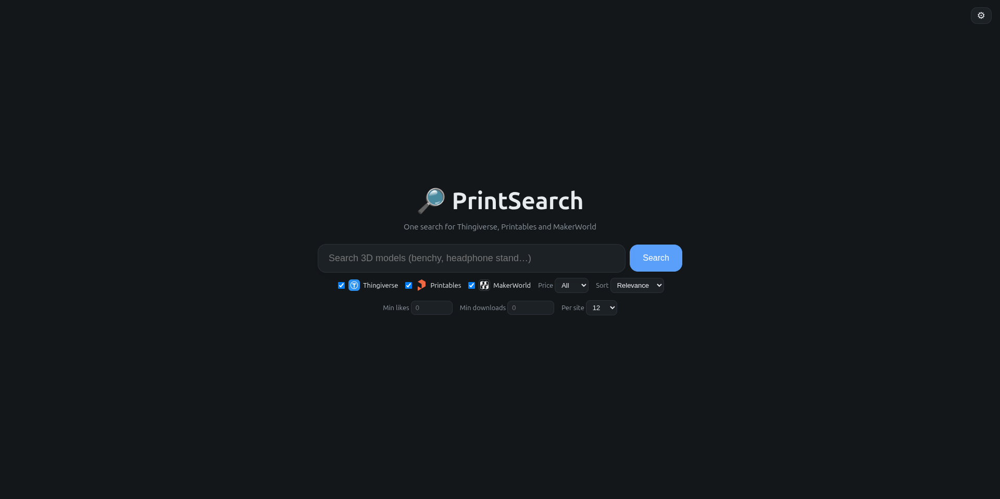
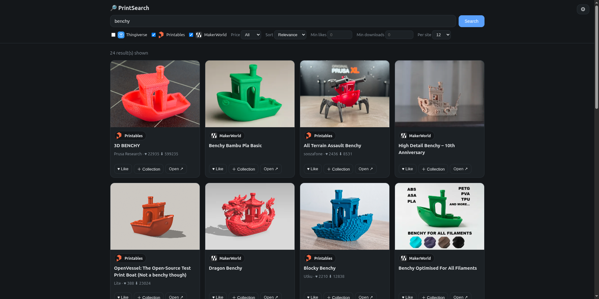

# PrintSearch

**English** · [Français](README.fr.md)

One search box for 3D-printing models on **Thingiverse**, **Printables** and **MakerWorld**.
A small Rust application with a local web interface and a command-line mode: search the three sites at once, filter and sort the results, like a model or add it to a collection, and keep your recent searches. This was coded by Claude to ensure complete transparency; I could never have done this on my own—it would have taken me too long, and I don't have enough knowledge.



> **Not affiliated with Thingiverse, Printables or MakerWorld.** Names and logos belong to their respective owners and are used only to identify each source. See [Limitations & legal notes](#limitations--legal-notes).

<!-- Add a screenshot here:  -->

## Features

- Search **Thingiverse, Printables and MakerWorld** in parallel; results are interleaved by site.
- Filters: **sites, price (free / paid), sort (relevance / likes / downloads), minimum likes, minimum downloads, results per site**. Changing a filter re-runs the search automatically.
- **Load more results** pagination, with a short-lived cache so repeated searches are fast.
- **Like** and **add to collection** from the result cards (see [feature support](#feature-support)).
- **Search history** under the search bar (can be turned off) and a **language setting** (English by default, French available).
- Local only: the server listens on `127.0.0.1`, your tokens never leave your computer.
- Also usable from the **command line**.

## Requirements

| What | Why |
|---|---|
| [Rust](https://rustup.rs) (stable) | to build from source |
| **Google Chrome or Chromium** | MakerWorld has no usable public API, so it is read with a headless browser. Thingiverse uses it as a fallback when you have no token. |
| Windows only: *Visual Studio Build Tools* ("Desktop development with C++") | required by Rust on Windows |

No OpenSSL needed (the project uses `rustls`).

## Installation

### From source (Linux, macOS, Windows)

```bash
git clone https://github.com/<your-user>/printsearch.git
cd printsearch
cargo build --release
```

The binary is `target/release/printsearch` (`target\release\printsearch.exe` on Windows). The web interface and the icons are embedded in it: it is a single file.

### Debian / Ubuntu package (`.deb`)

```bash
cargo install cargo-deb
cargo deb
sudo apt install ./target/debian/printsearch_*_amd64.deb
```

Chromium is *recommended* by the package, so `apt` will offer to install it. After installation, "PrintSearch" appears in your application menu and `printsearch` is available in the terminal. Before distributing the package, fill in `maintainer` and `license` in `Cargo.toml`.

### Windows executable

Build on Windows with `cargo build --release`, then copy `target\release\printsearch.exe` anywhere. A console window stays open while the app runs: closing it stops the server. Windows SmartScreen or the firewall may show a prompt on first launch (the server only listens locally, you can allow it).

## Usage

### Web interface



Run `printsearch` with no argument: it starts the local server and opens your browser on **http://localhost:8787**.

```bash
printsearch            # starts the server and opens the browser
printsearch serve      # starts the server only (add --open to open the browser)
```

Type a query, press Enter. Use the filter row under the search bar; the ⚙ button (top right) opens the **Settings** page.

### Command line

```bash
printsearch search "benchy"
printsearch search "headphone stand" --sites thingiverse,printables -l 5
printsearch search "vase" --price free --sort likes --min-likes 100 --page 2

printsearch login thingiverse                      # OAuth (see below)
printsearch login printables --token <TOKEN>
printsearch like thingiverse 763622
printsearch collect thingiverse <COLLECTION_ID> 763622
```

`-l/--limit` is the number of results *per site* and *per page*; `--page` starts at 1.

## Connecting your accounts

**Searching works without any account** on Printables and MakerWorld. Connecting is only needed for actions on your account (like, collections) and, on Thingiverse, for faster and richer search.

Everything is done in **⚙ Settings → Site connections**: each site has a status badge and a field to paste a token. Click **Save token**; use **Disconnect** to remove it.

### Thingiverse

Without a token, search reads the website with Chrome (slower; no author, likes or downloads). With a token it uses the official API: fast, with author, likes and downloads. A token is **required for Like and collections**.

**Option A, App Token (simplest).**
1. Sign in at <https://www.thingiverse.com/developers> and create an app.
2. Copy its **App Token**.
3. Paste it in Settings → Thingiverse → *Save token*.

**Option B, OAuth login.**
1. Create an app at <https://www.thingiverse.com/developers> and set the redirect URI to `http://localhost:8787/callback`.
2. Set your credentials **before** starting the app:

   ```bash
   # Linux / macOS
   export THINGIVERSE_CLIENT_ID="..."
   export THINGIVERSE_CLIENT_SECRET="..."
   printsearch serve
   ```
   ```powershell
   # Windows PowerShell
   $env:THINGIVERSE_CLIENT_ID="..."; $env:THINGIVERSE_CLIENT_SECRET="..."
   .\printsearch.exe serve
   ```
3. In Settings, a **Connect with Thingiverse** button appears. After authorizing, you come back to the Settings page.

The OAuth button does not appear when the app is launched from a menu or by double-click (no environment variables): use Option A there. The CLI equivalent is `printsearch login thingiverse`.

You can also set `THINGIVERSE_APP_TOKEN` as an environment variable instead of saving a token.

### Printables

Search works without a connection. To use **Like**, paste a Bearer token from your browser session:

1. Sign in on <https://www.printables.com>.
2. Open the developer tools (<kbd>F12</kbd>) → **Network** tab, then reload the page.
3. Click a request to `api.printables.com`; in **Request Headers**, copy the value after `Authorization: Bearer `.
4. Paste it in Settings → Printables → *Save token*.

These tokens **expire**: if Like starts failing, repeat the steps. Treat a token like a password.

### MakerWorld

Search works without a connection (Chrome required). Like and collections are **not implemented** for MakerWorld yet; the field exists in Settings for the future and currently has no effect.

### Where tokens are stored

In a `config.json` inside the application's configuration folder (typically `~/.config/printsearch/` on Linux, `%APPDATA%\printsearch\printsearch\config\` on Windows, `~/Library/Application Support/` on macOS), with owner-only permissions on Unix. Uninstalling does not delete it. **Language and search history** are stored separately, in your browser (`localStorage` for `localhost:8787`).

## Feature support

| | Thingiverse | Printables | MakerWorld |
|---|---|---|---|
| Search without login | ✅ via Chrome (slower, limited data) | ✅ | ✅ via Chrome (limited data) |
| Search with token | ✅ official API (fast, full data) | n/a | n/a |
| Author / likes / downloads | ✅ with token | ✅ | ❌ |
| Price filter | ✅ always free | ⚠️ best effort | ❌ unknown |
| Like | ⚠️ with token, experimental | ⚠️ with token, experimental | ❌ |
| Add to collection | ⚠️ with token, experimental | ❌ | ❌ |

⚠️ *Experimental*: Printables and MakerWorld endpoints are **not official**, and the Thingiverse like/collection routes were written from the public API description without being verified against a live account. They may need adjusting. Pull requests welcome.

When a value is unknown (for example likes on MakerWorld), the "min likes / min downloads" filters do not exclude the model, and an unknown price is treated as free by the *Free* filter.

## Troubleshooting

- **"Chrome/Chromium not found"**: install Google Chrome or Chromium and restart the app.
- **MakerWorld or Thingiverse returns nothing / "no result read"**: the site probably shows an anti-bot check (e.g. a page titled "Just a moment…"), which an automated browser cannot always pass. For Thingiverse, connect with an App Token to use the API instead. The error banner shows the title of the page that was read, which helps to diagnose.
- **Thingiverse is slow without a token**: that is the browser fallback; use an App Token.
- **Printables returns a GraphQL error or nothing**: the unofficial API may have changed; open an issue with the message.
- **Like fails**: your token may have expired or the route may have changed (see *Feature support*).
- **"Address already in use"**: port **8787** is fixed (the Thingiverse OAuth redirect depends on it). Close the other instance.
- **Server error messages are in French** for now; the interface itself is fully translated.

## Limitations & legal notes

- MakerWorld and Printables are accessed through **unofficial** means (a headless browser and an undocumented GraphQL endpoint). These can change or be blocked at any time, and their terms of service may restrict automated access. Use PrintSearch for **personal use, at a reasonable request rate**, and check each site's terms. You are responsible for how you use it.
- No affiliation with, or endorsement by, Thingiverse (MakerBot/UltiMaker), Printables (Prusa Research) or MakerWorld (Bambu Lab). Trademarks and logos are the property of their owners.
- Results, thumbnails and models belong to their authors; always respect each model's license.

## Project layout

```
src/main.rs            CLI (clap) and entry point
src/server.rs          local web server (axum) + JSON API
src/search.rs          multi-site search, merging, filters, sorting
src/browser.rs         headless Chrome reader (single shared instance, cache)
src/providers/         one file per site (Thingiverse, Printables, MakerWorld)
src/config.rs          token storage
web/index.html         the whole front-end (embedded in the binary)
web/icons/             site icons (replace to change them, then rebuild)
packaging/             .desktop launcher and icon for the .deb
```

Adding a site means adding a file implementing the `Provider` trait in `src/providers/`.

## Contributing

Issues and pull requests are welcome, especially for verifying or fixing the experimental endpoints, adding sites, and translations (the `I18N` object in `web/index.html`).

## License

See the `LICENSE` file.
